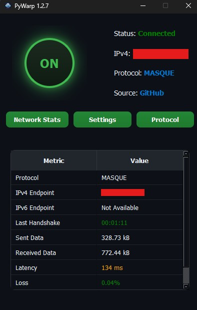
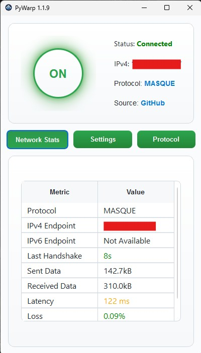

# PyWarp desktop application

This directory contains the PyWarp desktop application: a Python,
PySide6, Qt Quick, and QML controller for the official Cloudflare WARP
command-line client.

PyWarp is an independent open-source project. It does not provide a VPN service
and is not affiliated with or endorsed by Cloudflare.

## Download

You can always grab the latest version of the app from the **[GitHub Releases](../../releases/latest)** page.  
Choose the package that matches your operating system:

[](../../releases/latest)
[](../../releases/latest)
[](../../releases/latest)


## Features

- Live WARP status, connection controls, traffic, handshake, and route quality
- WARP, WARP + DoH, WARP + DoT, DNS-only, proxy, and tunnel-only modes
- WireGuard and MASQUE controls with capability detection
- Quick Smart Route testing for the first working connection
- Full Smart Route comparison with persisted latency and packet-loss results
- Custom endpoints and IP or hostname split-tunnel exclusions
- Personal and supported Zero Trust registration management
- Difficult-network compatibility controls
- Structured activity, optional DNS events, Tiny Mode, and system tray support
- English, Persian, Russian, and Simplified Chinese interface translations


## Screenshots





## Requirements

- Python 3.12 for source development
- The official Cloudflare WARP client and `warp-cli`
- Dependencies listed in `requirements.txt`

## Run from source

```bash
python -m venv .venv
```

Activate the environment:

```bash
# Linux or macOS
source .venv/bin/activate

# Windows PowerShell
.\.venv\Scripts\Activate.ps1
```

Then install and run:

```bash
python -m pip install --upgrade pip
python -m pip install -r requirements.txt
python main.py
```

PyWarp checks the standard Cloudflare WARP installation locations and `PATH`.
On supported apt, dnf, and yum Linux systems, its welcome guide can install
WARP from Cloudflare's official repository after explicit confirmation and
PolicyKit administrator approval.

## Source layout

```text
assets/          Branding, font, and locale data
backend/         WARP integration, background tasks, and Qt models
qml/components/  Shared Qt Quick controls
qml/pages/       Application workspaces
qml/theme/       Theme tokens and translations
main.py          Application entry point
```

## Release workflow

The GitHub-executable workflow is stored at
[`../.github/workflows/main.yml`](../.github/workflows/main.yml).

Some project download tools omit `.github`, so this directory also contains the
visible copy [`github-build.yml`](github-build.yml). The two files should remain
byte-for-byte identical. GitHub Actions only executes the file under
`.github/workflows/`.

The workflow validates Python and QML, builds Windows x64, Linux x64, macOS
Apple Silicon, and macOS Intel packages, generates SHA-256 checksums, and
publishes a release. Its manual version input must match `CURRENT_VERSION` in
`backend/app_controller.py`.

## Runtime data

Preferences and cached Smart Route results use Qt's native `QSettings` backend.
`pywarp.log` is written to the operating system's per-user application-data
directory. Update installers are written to Downloads only after the user
starts an update.

PyWarp contacts Cloudflare for tunnel checks and package metadata, GitHub for
update metadata and release downloads, and public IP/geolocation services to
show the current route.

## Security

Report vulnerabilities privately through a
[GitHub security advisory](https://github.com/saeedmasoudie/pywarp/security/advisories/new)
or email [info@saeedmasoudie.ir](mailto:info@saeedmasoudie.ir). Do not disclose
an unpatched vulnerability in a public issue.

The complete policy is included in [`SECURITY.md`](SECURITY.md) and in the
repository root.

## Support the Project

If you enjoy my work and want to support future development, you can donate here:

[Donate via my official website](https://www.saeedmasoudie.ir/donate.html)

Every contribution helps keep the project alive. Thank you!

## License and notices

PyWarp is distributed under the GNU General Public License v3.0. Third-party
notices for the bundled Estedad font and CLDR-derived locale data are included
under `assets/`.
